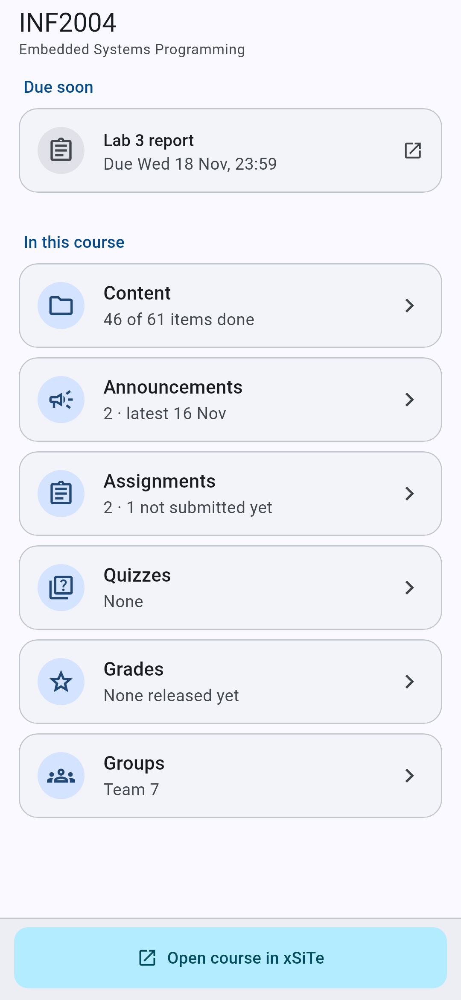

# reSIT

**One fast, secure app for everyday SIT student tasks.**

Today a student at the Singapore Institute of Technology moves between several separate systems, each with its own sign-in, layout and loading times:

| Task | Where it lives today |
| --- | --- |
| Timetable, exam slips, results, academic record | in4SIT (PeopleSoft) |
| Course content, announcements, assignments, quizzes, grades, groups | xSiTe (Brightspace) |
| Discussion-room booking | Room Booking System |
| Term dates, finals, breaks | The academic calendar page |

reSIT brings these into one app with one SIT sign-in. It is built for phones first and also runs on desktop. It talks to the same SIT systems as the student's own browser, using the student's own account. There is no reSIT server in between.

> reSIT is an independent student project. It is not made, endorsed or supported by SIT.

## Screens

All screenshots use made-up demo data.

| Home | Timetable | xSiTe courses |
| --- | --- | --- |
|  |  |  |

| A course | Academic progress (grades hidden) | Dark mode |
| --- | --- | --- |
|  |  |  |

## What it does

- **Home: what's next, at a glance.** It shows the class on now, the next class, and your next room booking. Below them are the teaching week, days to finals, days to the next break, and a countdown to your last final.
- **Timetable.** A weekly view coloured by module, with a colour key. Clashing classes are marked. The next week is fetched in the background, so paging forward is instant.
- **xSiTe in one place.** Work due soon and the latest announcements are gathered from every course you take this term. Each course shows its content progress, assignments (and whether you have submitted), quizzes, released grades and your groups. Items you have already read stay listed.
- **Exams and results.** It shows exam slips, released results, GPA by term and credits earned. **Grades are hidden by default** behind an eye toggle, so the app is safe to open in public.
- **Room booking.** Check your quota, find and book a discussion room, and see your bookings.
- **Academic calendar.** Term weeks, finals, breaks and public-holiday weeks.

## Why one app instead of the separate SIT sites

| | Separate SIT sites | reSIT |
| --- | --- | --- |
| Sign-in | Each system signs in separately, with repeated MFA prompts | One SIT sign-in. Each system's session is opened on demand. |
| Speed | Full web pages; PeopleSoft pages are slow and often time out | It requests only the data a screen needs, then shows it at once from an encrypted on-device cache while it refreshes |
| "What do I have next?" | Timetable, LMS and bookings each in a different system | One Home screen |
| Deadlines | Spread across every course page in xSiTe | One "Due soon" list across all courses |
| Mobile use | Desktop-first pages, pinch and zoom | Built for phones, with large tap targets and dark mode |
| Privacy in public | Grades are shown as soon as the page opens | Grades hidden until you tap |

## Benefits for SIT

- **Higher student satisfaction.** The daily friction students complain about most is slow pages, repeated sign-ins and information spread across systems. reSIT removes most of it.
- **Fewer missed deadlines and fewer support questions.** A single "Due soon" list and clear class and room details answer "where and when?" before students email staff or IT.
- **Less load on SIT systems.** reSIT caches what rarely changes, removes duplicate requests and limits how many requests run at once (at most 4 to xSiTe). One student opening the app costs the servers less than the same student clicking through each site.
- **A path to more student services, with official access.** With an official API, reSIT could add things that scraping cannot safely do. One example is **tuition-fee payment and reminders**: showing the amount due and the deadline on Home, sending a notification before it falls due, and paying in a few taps. That would encourage prompt fee payment and reduce the follow-up work for the Finance office.
- **Built by a student, for students,** in the open, with tests and an automated build for every platform.

## Security and privacy

Security is the first design concern, because the app handles a student's SIT account.

### Data stays between the device and SIT

- **No reSIT server.** The app connects directly to SIT's own servers over HTTPS. No password, cookie, timetable, grade or other student data is sent to the developer or to any third party.
- **No analytics, no ads, no tracking.**
- **Strict host allow-list.**
  - Sign-in is only accepted from SIT's sign-in server (`fs.singaporetech.edu.sg`).
  - Sign-in forms are only relayed to `*.singaporetech.edu.sg` over HTTPS.
  - Redirects to other hosts are refused.
  - Session cookies follow the `Secure` and `Domain` rules.

### On the device

- **Encrypted storage.** The SIT username, password and optional authenticator secret are kept in the platform's secure store:
  - Android: Keystore-backed encrypted preferences
  - iOS and macOS: Keychain, this device only, never synced
  - Windows: Windows data protection
  - Linux: the desktop keyring (libsecret)
- **Cached data is encrypted too.** Cached timetable, results and records are encrypted in the same way, and are **erased on sign-out**.
- **Excluded from backup.** Android cloud backup and device-to-device transfer are turned off for app data, so credentials never leave the phone in a backup.
- **Logs are redacted.** Passwords, cookies and tokens never appear in logs.
- **Grades are hidden by default** on every screen that shows them.

### Sign-in

- It uses SIT's own sign-in (ADFS), with SIT's MFA: Microsoft Authenticator push, or a code.
- A sign-in that is taking too long can be cancelled.
- Signing out also ends the SIT single sign-on session on the server, not just in the app.
- Every network request has a time limit, so nothing hangs indefinitely.

### Build and release

- The source is open for review.
- CI uses third-party GitHub Actions pinned to exact commit hashes.
- Signing keys are GitHub secrets, exposed only to the step that signs.
- Every release is built by CI from `main`; nothing is built on a personal machine.

### Known limitations, stated plainly

- reSIT reads SIT's web pages the way a browser does, because there is no public API. A change to SIT's pages can break a feature until the app is updated.
- The app keeps the SIT password on the device, so it can sign in again when a session expires. It is encrypted, but it is still a stored password. **Official OAuth or token-based access from SIT would remove the need to store it**, and is the change the project would most like to make with SIT's support.
- The optional on-device authenticator stores the MFA secret on the same phone as the password. It is off by default. Students who want two separate factors should keep using Microsoft Authenticator push.
- There has been no independent security audit yet.

## Platforms

| Platform | Status |
| --- | --- |
| Android | Built by CI (`.apk`, `.aab`) and published to Google Play internal testing |
| Windows | Built by CI (installer and portable `.zip`) |
| Linux | Built by CI (`.deb`) |
| iOS | Project included; needs a Mac build and an Apple developer account to ship |
| macOS | Project included; needs a Mac build, signing and notarisation to ship |
| Web | Not supported: browsers block cross-site requests to SIT's systems (CORS) |

Downloads are on the [Releases](../../releases) page.

## UX principles

- **The answer first.** Home answers "what's now, what's next, what's due" without a tap.
- **Fast by default.**
  - Saved data shows at once and refreshes in the background.
  - Each screen shows when it was last updated.
  - Pull down to refresh.
- **Errors in plain English** with a clear next step. Technical details are folded away for when they help.
- **Consistent building blocks.** One design system (Material 3), with shared cards, spacing, banners and buttons.
- **Within thumb reach.** Main actions sit in a bottom bar.
- **Accessible.**
  - Light and dark themes.
  - Text scales with the system font size.
  - Every class block is read as one item by screen readers.
  - Colour is never the only signal; the module code is always written.
- **Private by default.** Grades are hidden until asked for.

## Building

Requires Flutter 3.47 or newer.

```bash
flutter pub get
```

```bash
flutter test
```

```bash
flutter run
```

To regenerate the README screenshots from demo data:

```bash
flutter test tool/screenshots/readme_screens_test.dart --update-goldens
```

CI (`.github/workflows/build.yml`) builds Android, Windows and Linux on every push to `main` and publishes a release.

## Project layout

```
lib/
  core/        sign-in (ADFS + MFA), network client, secure storage, theme, shared widgets
  features/
    home/          Home screen
    timetable/     weekly timetable
    lms/           xSiTe (Brightspace) courses and activities
    exams/         exam slips, results, academic record
    room_booking/  discussion-room booking
    calendar/      academic calendar
    services/      services grid and overview
    settings/      account and sign-in options
test/        unit and widget tests
tool/        screenshot generator
```
