# reSIT

**One fast, secure app for everyday SIT student tasks.**

Today a student at the Singapore Institute of Technology uses three separate systems, plus the academic calendar page:

| System | What it's for |
| --- | --- |
| **in4SIT** (PeopleSoft) | Administrative matters: timetable, exam slips, results, academic record |
| **xSiTe** (Brightspace) | The learning management system: course content, announcements, assignments, quizzes, grades, groups |
| **RBS** (Room Booking System) | Discussion-room booking |

Students' three main complaints:

1. **Microsoft MFA for every site.** in4SIT, xSiTe and RBS each ask for their own sign-in, with its own Authenticator prompt.
2. **Slow, inefficient pages.** in4SIT pages in particular take seconds to load and often time out.
3. **UI not designed for phones.** The sites are desktop-first, so on a phone they mean pinching, zooming and hunting through menus.

reSIT brings the three systems into one app with **one SIT sign-in and one MFA approval**. It is built for phones first, also runs on desktop, and **keeps working when SIT's systems are down**: the timetable and the next class stay available from a saved copy.

It talks to the same SIT systems as the student's own browser, using the student's own account. There is no reSIT server in between.

> reSIT is an independent student project. It is not made, endorsed or supported by SIT.

## Screens

All screenshots use made-up demo data.

| Home | Timetable | xSiTe courses |
| --- | --- | --- |
| 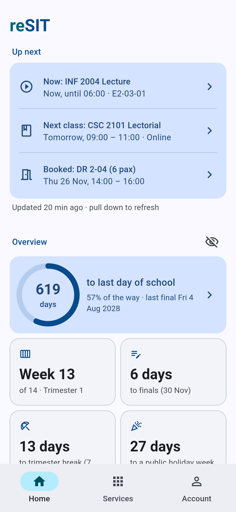 | 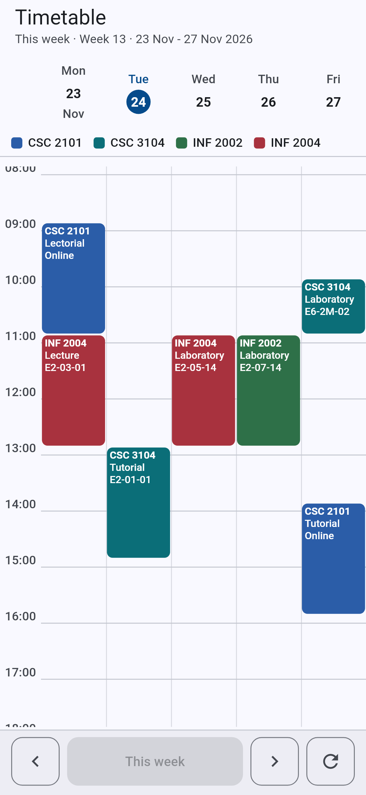 | 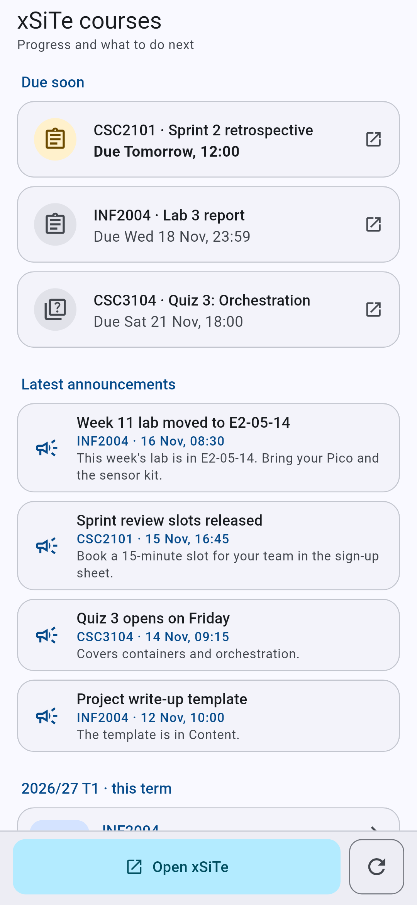 |

| A course | Academic progress (grades hidden) | Offline: SIT unreachable |
| --- | --- | --- |
|  | 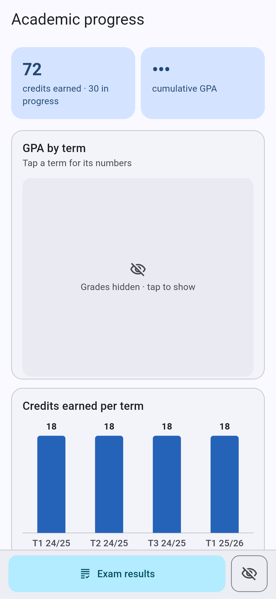 | 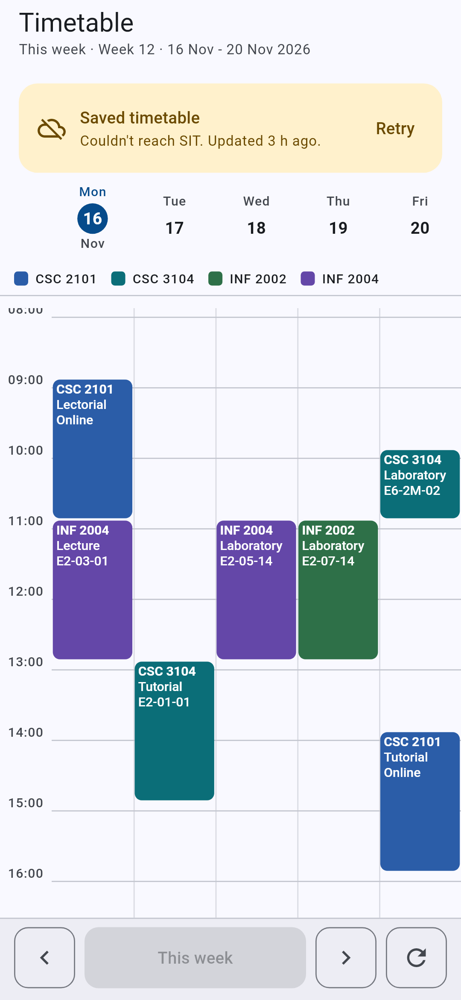 |

| Security settings | App lock | Dark mode |
| --- | --- | --- |
| 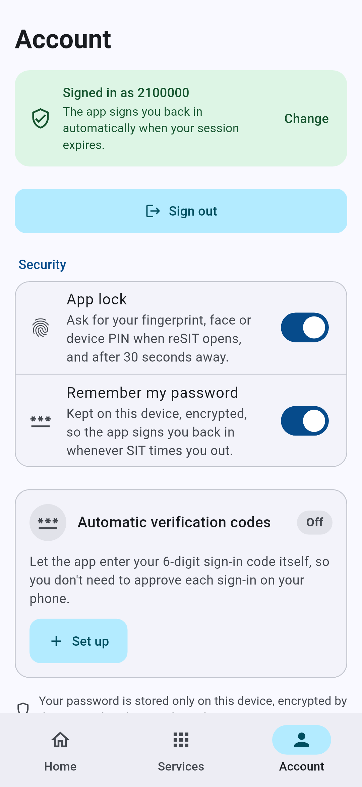 | 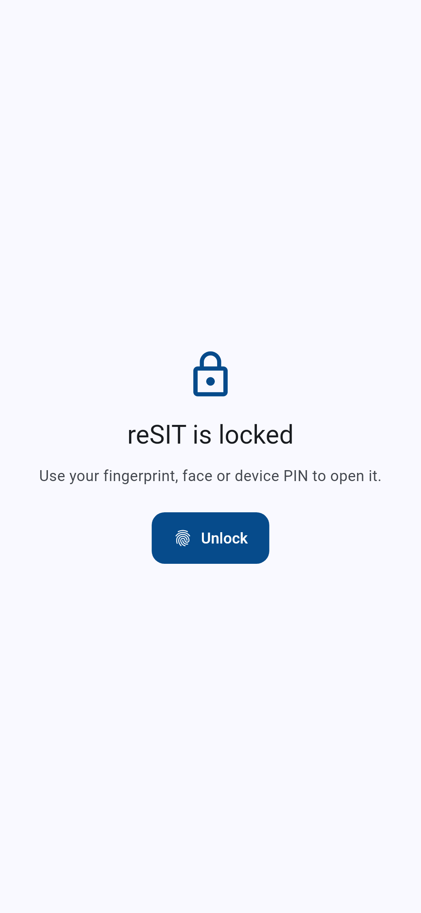 | 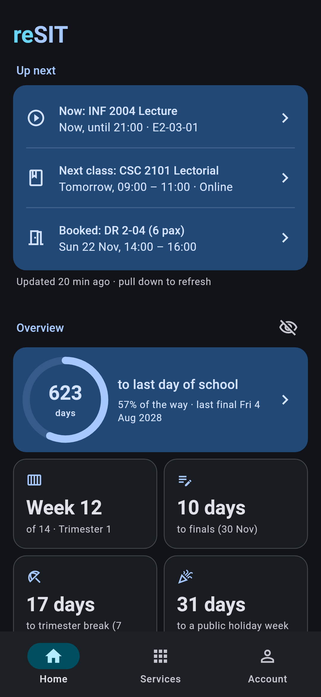 |

### Desktop (Windows, Linux, macOS)

On a desktop window, reSIT is laid out like a desktop app:
- a sidebar lists every part of the app, grouped by SIT system (in4SIT, xSiTe, room booking), and stays visible as you open courses or bookings
- each screen's actions sit in a toolbar at the top
- Home is a two-column dashboard with a Refresh button (also Ctrl+R or F5)

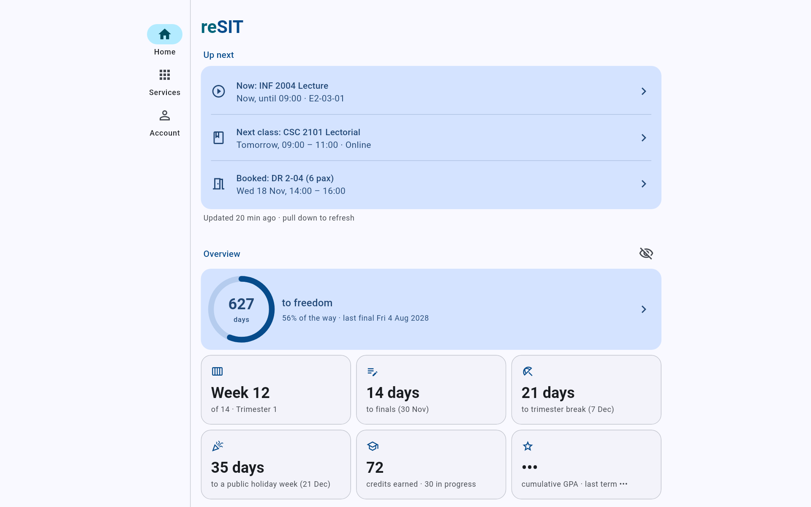

| Timetable | xSiTe courses |
| --- | --- |
| 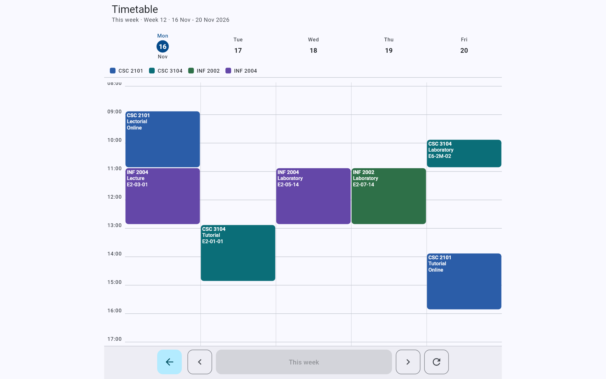 | 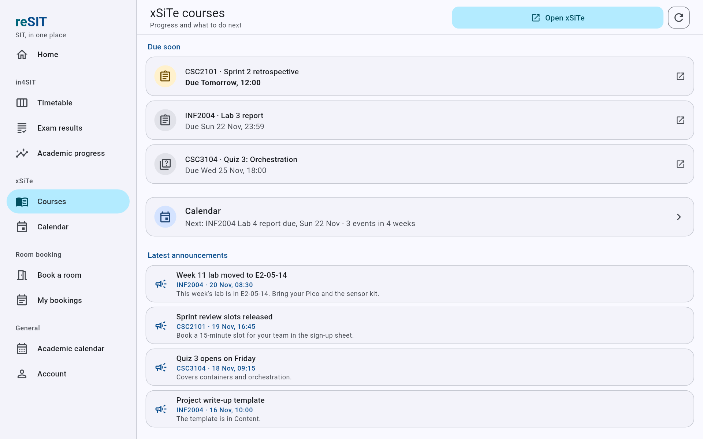 |

## What it does

- **Home: what's next, at a glance.** It shows the class on now, the next class, and your next room booking. Below them are the teaching week, days to finals, days to the next break, and a countdown to your last final.
- **Timetable.** A weekly view coloured by module, with a colour key. Clashing classes are marked. The next week is fetched in the background, so paging forward is instant.
- **Works offline and during outages.** The weeks you have opened are kept on the device, encrypted. They open instantly, and they stay readable when in4SIT is slow, down for maintenance or taken offline, for example to patch a security issue. A banner says it's a saved copy and how old it is. Home's "Up next" works the same way.
- **xSiTe in one place.** Work due soon and the latest announcements are gathered from every course you take this term. Each course shows its content progress, assignments (and whether you have submitted), quizzes, released grades and your groups. Items you have already read stay listed.
- **Exams and results.** It shows exam slips, released results, GPA by term and credits earned. **Grades are hidden by default** behind an eye toggle, so the app is safe to open in public.
- **Room booking.** Check your quota, find and book a discussion room, and see your bookings.
- **Academic calendar.** Term weeks, finals, breaks and public-holiday weeks.

## Why one app instead of the separate SIT sites

| | Separate SIT sites | reSIT |
| --- | --- | --- |
| Sign-in and MFA | in4SIT, xSiTe and RBS each ask for a sign-in and a Microsoft Authenticator approval | One SIT sign-in and one MFA approval; each system's session is opened on demand behind it |
| Speed | Full web pages; in4SIT pages are slow and often time out | Requests only the data a screen needs; shows the saved copy at once while it refreshes |
| SIT system down | Nothing to see | Saved timetable and next class still shown, marked with their age |
| "What do I have next?" | Timetable, LMS and bookings each in a different system | One Home screen |
| Deadlines | Spread across every course page in xSiTe | One "Due soon" list across all courses |
| Mobile use | Desktop-first pages: pinch, zoom, deep menus | Built for phones: everything within thumb reach, large tap targets, dark mode |
| Privacy in public | Grades are shown as soon as the page opens | Grades hidden until you tap |

### Measured: loading the weekly timetable

| | in4SIT in a browser | reSIT |
| --- | --- | --- |
| Requests from the device to in4SIT's site | **47** | **1** |
| Data transferred | **278 kB** | **13 kB** (about 21× less) |
| Scripts, styles and images to unpack and run | **2.8 MB** | none |
| Opening it again later | the page and its resources again | **0 requests** (saved copy) |

Only 1 of the browser's 47 requests is the timetable itself (the 13 kB `SSR_SSENRL` page, the same one reSIT asks for). The other 46 are PeopleSoft scripts, stylesheets and images. in4SIT sits behind a web firewall and cache (Imperva), which can answer some of those files itself, so these numbers measure what the student's device sends and downloads, not exactly what reaches SIT's servers. The page that does reach in4SIT's application is the timetable page, and reSIT asks for it once and then not again until it refreshes. The first visit to each week can take reSIT 1–2 extra requests (switching in4SIT to the weekly view, or signing in again after a timeout).

<details>
<summary>Browser capture (Chrome DevTools, Network tab)</summary>

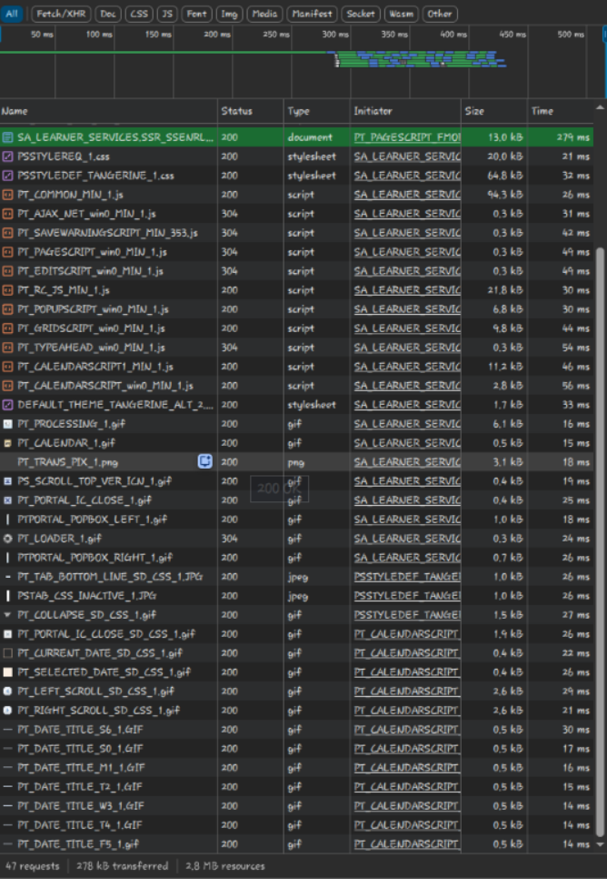

</details>

## Benefits for SIT

- **Higher student satisfaction.** reSIT removes most of the friction students complain about daily: repeated MFA prompts, slow pages, and sites that are hard to use on a phone.
- **Resilience during outages.** When in4SIT is down, students can still see where their next class is. That means fewer students stranded, and fewer queries to staff, during an incident.
- **Fewer missed deadlines and fewer support questions.** A single "Due soon" list and clear class and room details answer "where and when?" before students email staff or IT.
- **Lighter on students' devices and on SIT's sites.** Loading the timetable takes reSIT 1 request and 13 kB, against 47 requests and 278 kB in a browser (see [Measured](#measured-loading-the-weekly-timetable)). The timetable page itself, the part in4SIT has to build, is fetched once and not again when the student reopens it. reSIT also caches what rarely changes, removes duplicate requests and limits how many run at once (at most 4 to xSiTe).
- **A path to more student services, with official access.** With an official API, reSIT could add things that scraping cannot safely do. One example is **tuition-fee payment and reminders**: showing the amount due and the deadline on Home, sending a notification before it falls due, and paying in a few taps. That would encourage prompt fee payment and reduce the follow-up work for the Finance office.
- **Built by a student, for students,** in the open, with tests and an automated build for every platform.

## Security and privacy

Security is the first design concern, because the app handles a student's SIT account.

### Data stays between the device and SIT

- **No reSIT server.** The app connects directly to SIT's own servers over HTTPS. No password, cookie, timetable, grade or other student data is sent to the developer or to any third party.
- **No analytics, no ads, no tracking.**
- **Strict host allow-list.**
  - Sign-in is only accepted from SIT's sign-in server (`fs.singaporetech.edu.sg`).
  - Sign-in forms are only relayed to `*.singaporetech.edu.sg` over HTTPS.
  - Redirects to other hosts are refused.
  - Session cookies follow the `Secure` and `Domain` rules.

### On the device

- **App lock.** reSIT can ask for the fingerprint, face or device PIN when it opens, and again after 30 seconds in the background. While it's in the background, the app switcher shows a cover instead of your data. Turning the lock on or off needs the same check, so someone holding an unlocked phone can't simply switch it off. The lock is available on Android, iOS, macOS and Windows (Windows Hello).
- **Your choice whether the password is kept.** "Remember my password" is on by default, because SIT's sessions time out often and signing in again each time is the main complaint. Students who prefer not to store it can turn it off; the password is then held in memory only and entered again after the app is closed.
- **The saved password is never shown.** It is not filled back into any form, so "show password" can't reveal it.
- **Encrypted storage.** The SIT username, password and optional authenticator secret are kept in the platform's secure store:
  - Android: Keystore-backed encrypted preferences
  - iOS and macOS: Keychain, this device only, never synced
  - Windows: Windows data protection
  - Linux: the desktop keyring (libsecret)
- **Cached data is encrypted too.** Cached timetable, results and records are encrypted in the same way, and are **erased on sign-out**.
- **Excluded from backup.** Android cloud backup and device-to-device transfer are turned off for app data, so credentials never leave the phone in a backup.
- **Logs are redacted.** Passwords, cookies, tokens, query strings and page text (which could hold a name or ID) never appear in the troubleshooting log, and it is cleared on sign-out.
- **Nothing is left behind.** "Sign out and forget my details" also removes the module list, graduation year and booking preferences. On iPhone and Mac, where the system keychain outlives the app, a reinstalled app wipes the previous install's saved login.
- **The verification-code secret** is never suggested to be sent by email or chat, is cleared from the clipboard once saved, and the keyboard is told not to learn it.
- **Grades are hidden by default** on every screen that shows them.

### Sign-in

- It uses SIT's own sign-in (ADFS), with SIT's MFA: Microsoft Authenticator push, or a code.
- **It never repeats a rejected password.** If SIT turns the saved password down (for example, after it was changed in a browser), the app stops using it until the student enters the new one, so it can't lock the SIT account. Automatic sign-ins are also capped at a few an hour.
- Sign-in tokens are only accepted from SIT's sign-in server, and links inside xSiTe replies are only followed when they stay on xSiTe.
- Cookies can't be scoped wider than SIT (a cookie for all of `edu.sg` is refused).
- Requests identify themselves honestly: the user agent ends in `reSIT/1.0 (unofficial SIT student app)`, so SIT's IT can tell the app's traffic apart in their logs and in their web firewall, and allowlist or rate-limit it.
- A sign-in that is taking too long can be cancelled.
- Signing out also ends the SIT single sign-on session on the server, not just in the app.
- Every network request has a time limit, so nothing hangs indefinitely.

### Build and release

- The source is open for review.
- CI pins every GitHub Action, GitHub's own included, to an exact commit hash.
- A release is refused unless the Android build is signed with the project's release key, and every release lists SHA-256 checksums of its files.
- Signing keys are GitHub secrets, exposed only to the step that signs.
- Every release is built by CI from `main`; nothing is built on a personal machine.

### Known limitations, stated plainly

- reSIT reads SIT's web pages the way a browser does, because there is no public API. A change to SIT's pages can break a feature until the app is updated.
- By default the app keeps the SIT password on the device, so it can sign in again when a session times out. It is encrypted and protected by the app lock, but it is still a stored password. **Official OAuth or token-based access from SIT would remove the need to store it**, and is the change the project would most like to make with SIT's support.
- The optional on-device authenticator stores the MFA secret on the same phone as the password. It is off by default. Where the device supports it, turning it on also turns on the app lock, so the phone's owner (fingerprint, face or PIN) is still required. Students who want two fully separate factors can keep using Microsoft Authenticator push.
- Some features have been built from public documentation and not yet tested on every kind of account: xSiTe assignments, quizzes, grades and groups. (Cancelling a room booking uses the same request as RBS's own Cancel button.) With access to SIT's backend APIs these would be both simpler to build and fully verified.
- The app lock is a check in the app, not a lock on the stored secrets themselves (they are protected by the operating system's encrypted storage). On Windows that storage is readable by other programs running as the same user.
- There has been no independent security audit yet. An internal review was done; its findings are fixed or listed here.

## Platforms

| Platform | Status |
| --- | --- |
| Android | Built by CI (`.apk`, `.aab`) and published to Google Play internal testing |
| Windows | Built by CI (installer and portable `.zip`) |
| Linux | Built by CI (`.deb`) |
| iOS | Included in the code, **not yet built or tested**: building and installing needs a Mac and an Apple developer account |
| macOS | Included in the code, **not yet built or tested**: needs a Mac and an Apple developer account for signing and notarisation |
| Web | Not supported: browsers block cross-site requests to SIT's systems (CORS) |

Downloads are on the [Releases](../../releases) page.

## UX principles

- **The answer first.** Home answers "what's now, what's next, what's due" without a tap.
- **Fast by default.**
  - Saved data shows at once and refreshes in the background.
  - When SIT can't be reached, saved data stays on screen with its age, instead of an error page.
  - Each screen shows when it was last updated.
  - Pull down to refresh.
- **Errors in plain English** with a clear next step. Technical details are folded away for when they help.
- **Consistent building blocks.** One design system (Material 3), with shared cards, spacing, banners and buttons.
- **Within thumb reach.** Main actions sit in a bottom bar on phones; desktop windows get a side rail and a readable column.
- **Accessible.**
  - Light and dark themes.
  - Text scales with the system font size.
  - Every class block is read as one item by screen readers.
  - Colour is never the only signal; the module code is always written.
- **Private by default.** Grades are hidden until asked for.

## Building

Requires Flutter 3.47 or newer.

```bash
flutter pub get
```

```bash
flutter test
```

```bash
flutter run
```

To regenerate the README screenshots from demo data:

```bash
flutter test tool/screenshots/readme_screens_test.dart --update-goldens
```

CI (`.github/workflows/build.yml`) builds Android, Windows and Linux on every push to `main` and publishes a release.

## Project layout

```
lib/
  main.dart     starts the app
  app/          app shell: phone tabs, desktop sidebar, app lock
  core/         shared: automatic sign-in, network client, encrypted storage, theme, widgets
  sites/        the code that talks to each SIT system
    adfs/         SIT sign-in and MFA
    in4sit/       timetable and exam results
    xsite/        courses, content, assignments, quizzes, grades, groups
    rbs/          room booking
    sit_website/  academic calendar
  features/     one folder per part of the app, each with
                domain/ (models), data/ (saved copies) and ui/ (screens)
test/         unit and widget tests
tool/         screenshot generator
```

See [docs/ARCHITECTURE.md](docs/ARCHITECTURE.md) for the layers and rules.
